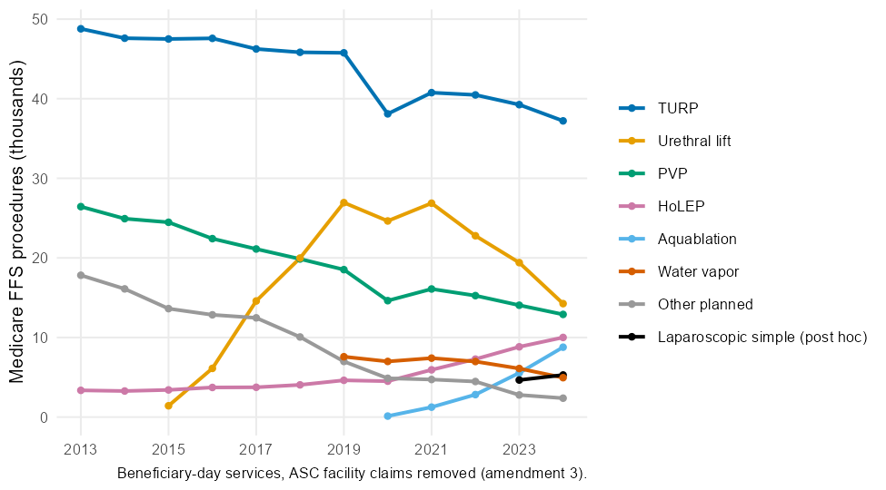
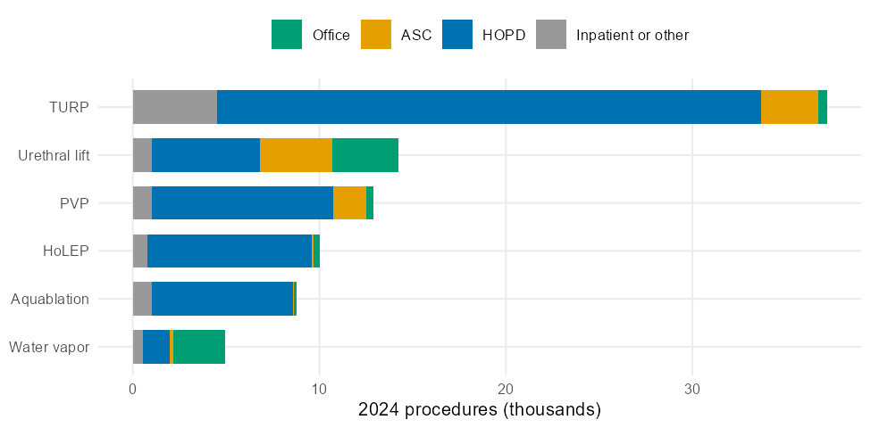
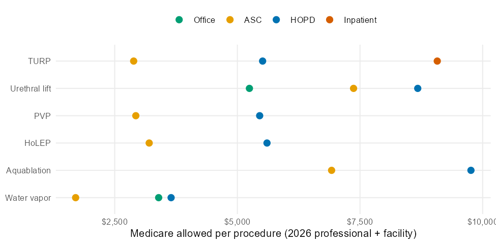
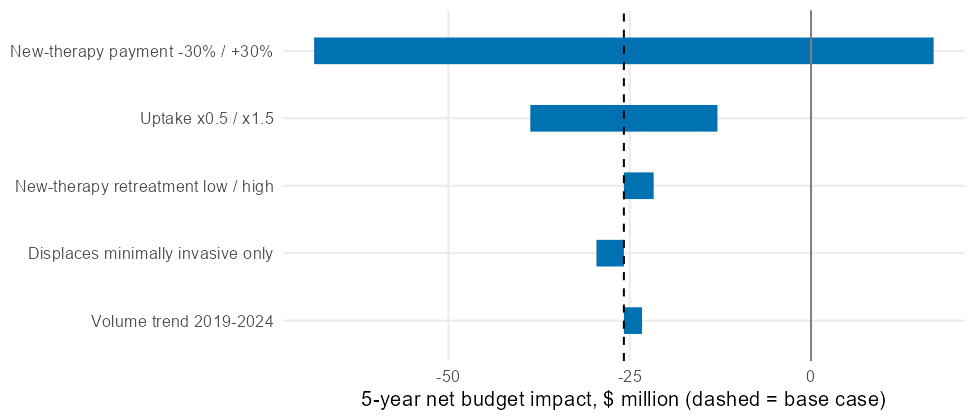

# Readout: BPH procedures in Medicare and the budget impact of a new office-based therapy

The plan is in [design.md](design.md). It was written before any BPH rows were pulled, and the three amendments there say what changed after that and why. Numbers below come from `results/`.

## What the claims say

Medicare fee-for-service paid for about 90,500 first procedural treatments of BPH in 2024 (beneficiary-day services in the Physician & Other Practitioners file, with ambulatory surgical center facility claims removed). TURP is still 41% of them. The mix moved a lot in ten years:

- Urethral lift went from its first year of coding (1,419 procedures in 2015) to about 26,900 in 2019 and 2021, then fell to 14,254 in 2024.
- Waterjet ablation (0421T) went from 125 procedures in 2020 to 8,780 in 2024, and laser enucleation (HoLEP) roughly tripled from 2015 (3,412) to 2024 (10,005).
- TURP fell 22% from 2015 to 2024 and laser vaporization fell 47%.
- Inpatient transurethral prostatectomy (MS-DRGs 713-714) fell from 8,128 to 4,966 discharges.
- A laparoscopic simple prostatectomy code that includes robotic assistance (CPT 55867, added post hoc) shows up from 2023, with 5,287 procedures in 2024. In the same year the open simple prostatectomy codes fell from 2,214 to 792, so the shift to minimally invasive simple prostatectomy is visible in the first year the code was used.

Where the procedures happen depends on the procedure. In 2024, 56% of water vapor treatments and 25% of urethral lifts were done in the office, against about 1% of TURPs. Most TURPs (29,136) were in hospital outpatient departments, 3,097 in ASCs, and 4,530 were inpatient or in facilities outside the outpatient file. That last number lines up with the 4,966 inpatient discharges in MS-DRGs 713-714, which is a useful cross-check between two files built from different claim types.

Two coding details mattered for the counts.

1. The facility rows of the physician file include facility claims that ASCs bill on the professional claim form. Without removing them, every ASC procedure is counted twice and the average payment is pulled up by the ASC facility fee: $2,360 per TURP from ASCs against $708 from urologists in the provider-level file. The planned payment check (K2) caught this.
2. Hospitals and ASCs bill urethral lift as HCPCS C9739 or C9740, not as the CPT codes the surgeon uses. The outpatient file has no 52441 rows at all, so a code list built only from CPT misses every hospital and ASC lift. With the C-codes, 2024 urethral lifts split into 3,562 office, 3,870 ASC, 5,808 HOPD and 1,014 other.

## What Medicare pays at each site

Professional fees come from the CY2026 Physician Fee Schedule, facility fees from the 2024 outpatient and ASC claims, and inpatient payments from FY2027 MS-DRG weights (operating plus capital, no hospital-specific add-ons).

| Procedure | Office | ASC | HOPD | Inpatient |
|---|---|---|---|---|
| TURP | not payable | $2,886 | $5,514 | $9,075 (DRG 714) |
| Urethral lift | $5,245 | $7,368 | $8,677 | |
| Water vapor | $3,396 | $1,703 | $3,649 | |
| Laser vaporization | not payable | $2,930 | $5,454 | |
| HoLEP | not payable | $3,202 | $5,604 | |
| Waterjet ablation | | $6,921 | $9,761 | |

The office urethral lift price includes the implants: the surgeon bills one 52441 and, in the office, an average of 4.6 add-on 52442 implants. The same procedure costs Medicare 65% more in the HOPD than in the office.

The fee schedule changed a lot between 2024 and 2026, which is why the planned check of 2024 claims against 2026 rates failed for several codes. The facility rate for TURP fell 27% (work RVU 13.16 to 9.75), laser vaporization fell 23% and lost its office rate, HoLEP fell 20%, and the office rate for water vapor therapy roughly doubled (total RVU 49.69 to 101.66). Checked against the CY2024 schedule instead, the professional claims average is within 8% of the fee schedule for TURP, laser vaporization, HoLEP and urethral lift in both settings, and for water vapor therapy in the office. It is still 26-28% high for water vapor therapy in facilities and for resection of regrown tissue, where ASCs too small to be listed in the provider file stay in the counts, and 24% low for laparoscopic simple prostatectomy.

## Retreatment rates from the literature

| Procedure | Study (PMID) | Follow-up | Surgical retreatment | Per year |
|---|---|---|---|---|
| TURP | Austrian national registry, 23,123 cases (15774249) | 5 years | 5.8% | 1.2% |
| Laser vaporization (80-W) | single-center RCT vs TURP (29447947) | 5 years | 14.3% | 2.9% |
| HoLEP | single-center series, 118 patients (17498867) | 4.1 years (mean) | 4.2% | 1.0% |
| Urethral lift | L.I.F.T. sham-controlled RCT (28646935) | 5 years | 13.6% | 2.7% |
| Water vapor | sham-controlled RCT (33872051) | 5 years | 4.4% | 0.9% |
| Waterjet ablation | WATER RCT vs TURP (39539565) | 5 years | 5% | 1.0% |

Every number is matched against its PubMed abstract by `scripts/04_literature.R`. The laser vaporization study used the older 80-W laser, and the HoLEP series is a single center's learning-curve cohort, so both are weak benchmarks.

## Budget impact of a new office-based therapy

The model follows the ISPOR 2014 good-practice report: Medicare fee-for-service allowed amounts, 90,479 first procedures a year (held flat), the 2024 mix and site of service, 2026 payment rates, and a hypothetical office therapy that reaches 2%, 4%, 6%, 8% and 10% of first procedures in years 1-5 and is paid like an office urethral lift ($5,245). It takes share from every family in proportion to its share, and its patients are retreated at the water vapor rate.

Over five years Medicare would spend $2.861 billion on these procedures and their retreatments without the new therapy and $2.835 billion with it, a saving of $25.8 million (0.9%), or $951 per patient treated with the new therapy. The saving comes from paying $5,245 instead of the current average of $6,141 per first procedure, most of which are done in hospital outpatient departments, and from a lower retreatment rate (0.9% a year against a current average of 1.6%).

The result is driven by the payment. At 30% above parity the therapy adds $16.9 million over five years, and it breaks even at $6,196 per procedure. Uptake only scales the result. If the therapy displaces only the other minimally invasive therapies, the saving grows to $29.6 million, mainly because urethral lift, the largest of them, has the highest retreatment rate after laser vaporization. Retreatment at the highest family rate cuts the saving to $21.7 million.

The same model is in `results/bph_budget_impact_model.xlsx`, built cell by cell with formulas, so every input can be changed in Excel. It matches the R model to within a millionth of a dollar in every year and every sensitivity case (K1).

## Verdicts

| | Prediction or check | Result | Met |
|---|---|---|---|
| P1 | TURP falls by at least 20%, 2015-2024 | -18.8% as planned, -21.7% after removing ASC claims | No |
| P2 | Urethral lift + water vapor share rises and reaches 20% | 6.3% in 2016, 20.2% in 2024 | Yes |
| P3 | Office share of urethral lift rises | 38.1% in 2016, 25.0% in 2024 | No |
| P4 | MS-DRG 713-714 discharges fall by at least 30% | 8,128 to 4,966 (-38.9%) | Yes |
| P5 | Office cheaper than HOPD wherever both are paid | urethral lift, water vapor, TUNA | Yes |
| P6 | Payment is the most influential input | payment swing $42.7M, uptake $12.9M | Yes |
| K1 | R and Excel agree within $1 | largest gap about $0.000001 | Pass |
| K2 | Facility claims within 20% of the 2026 rate | 2 of 7 codes | Fail |
| K3 | Office claims within 20% of the 2026 rate | 2 of 3 codes | Fail |
| K4 | Every planned code found | 14 of 14 | Pass |
| K5 | State rows add up to 95-100% of national | 7 of 11 families; small families lose suppressed cells | Fail |

P1 misses on the planned measure and would pass on the corrected one; the verdict stays as planned. P3 went the other way from what I expected: the growth of urethral lift after 2019 came from ASCs and hospitals, and the office share fell while total volume dropped. The two failed payment checks led to amendment 3, and the re-run on professional claims against the same year's fee schedule passes for 8 of 10 code and site pairs.

## Limits

- These are national summaries of Medicare fee-for-service claims, not patient-level data. They have no diagnoses, so the procedures are defined by procedure codes alone, and they cannot follow a patient from a first procedure to a retreatment. Medicare Advantage, about half of beneficiaries, is not in them.
- Rows for ASCs with fewer than 11 beneficiaries for a code are suppressed in the provider-level file, so a few ASC procedures are still counted twice.
- Facility fees are 2024 averages; professional fees are 2026 rates. Hospital-specific inpatient add-ons (indirect medical education, disproportionate share, outliers) are left out.
- The new therapy is hypothetical, and its payment and retreatment rate are assumptions. Complications, catheterization, medication and office visits are not costed.
- Annual retreatment rates spread 5-year cumulative rates evenly, from trials with selected patients.
